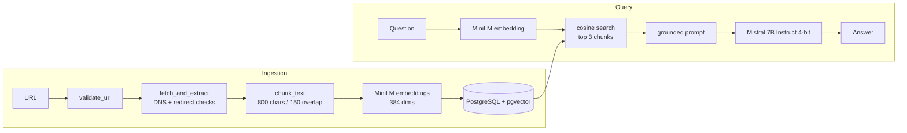

# Architecture and design decisions

## Module map

| Module | Responsibility |
|---|---|
| `url_validation.py` | Accept only public http(s) URLs on ports 80/443; no credentials, localhost or private IPs |
| `fetcher.py` | Resolve DNS and re-check on every redirect, cap download size, HTML only, extract text with trafilatura |
| `chunking.py` | Overlapping fixed-size character chunks |
| `embeddings.py` | Lazy-loaded sentence-transformers model |
| `database.py` | pgvector insert (idempotent) and cosine-similarity search |
| `llm.py` | Lazy-loaded local Mistral 7B, deterministic greedy decoding |
| `pipeline.py` | Orchestration: ingest, retrieve, build prompt, generate |
| `app.py` | Gradio user interface |

## Decisions

- **Why RAG instead of pasting the page into the model?** Context limits, speed, and focus:
  the model only sees the few passages relevant to the question.
- **Why overlap?** A sentence cut at a chunk boundary still appears whole in a neighbour.
- **Why a separate embedding model?** MiniLM is small and built for similarity; Mistral is built for generation.
- **Why check DNS and every redirect?** A public-looking URL can resolve or redirect to an
  internal address (SSRF). Each hop is validated before it is requested.
- **Why treat webpage text as data?** The system prompt tells the model not to follow instructions
  found inside retrieved content (basic prompt-injection defence).
- **HTTP 403 from Wikipedia:** generic bot User-Agents are rejected. The fetcher sends a descriptive
  UA with contact details (`CONTACT_EMAIL`, `PROJECT_URL`) and retries once with a browser-style UA.
  This is covered by an automated test.

## Known limitations

- Only 3 chunks of ~800 characters are retrieved, so broad questions on very long pages get partial answers.
- JavaScript-rendered pages are not supported (no headless browser).
- Chunking is character-based, not sentence- or section-aware.
- Re-ingesting a page whose content changed keeps old chunks (`ON CONFLICT DO NOTHING`).
- The local Mistral model needs a GPU, so a free public demo would require swapping in a hosted LLM API.
